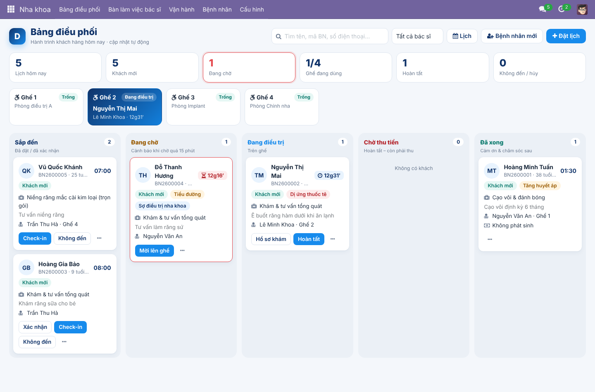
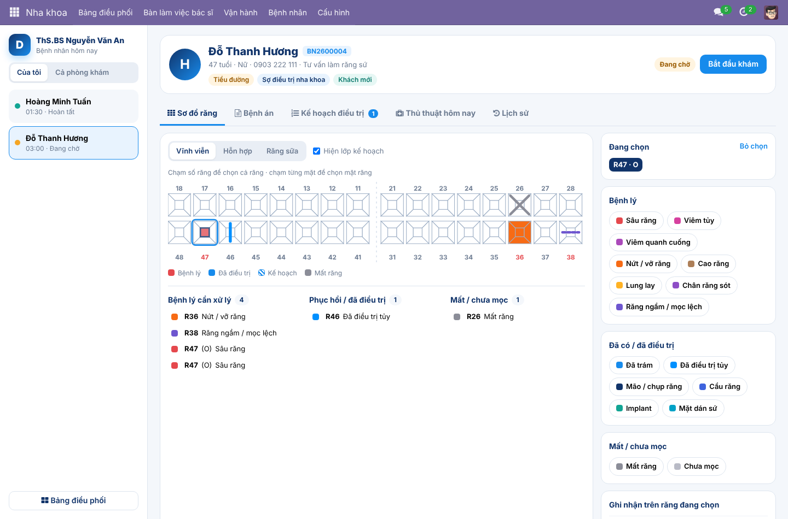
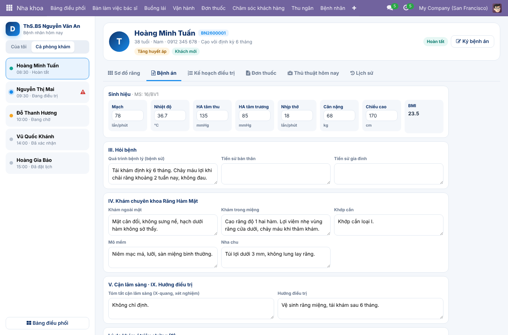
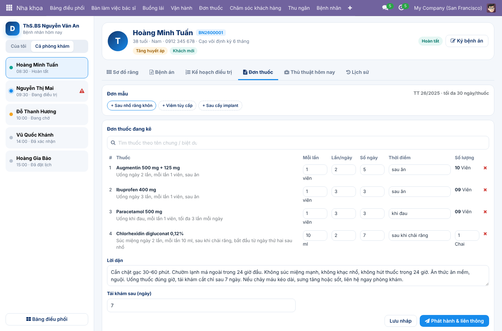
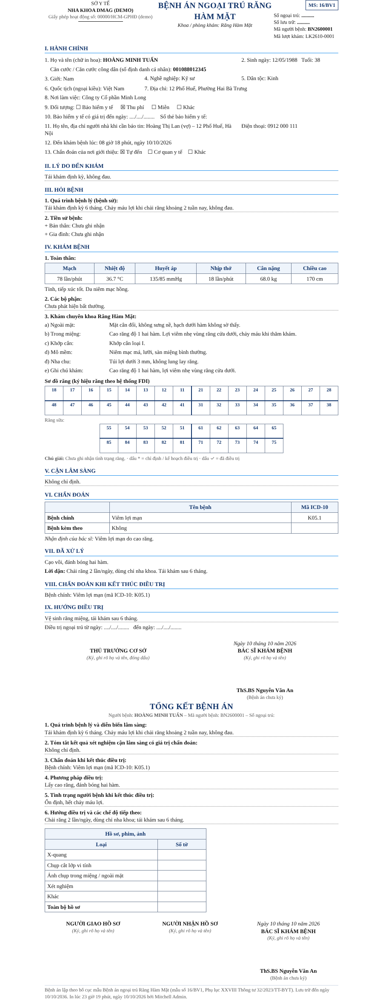
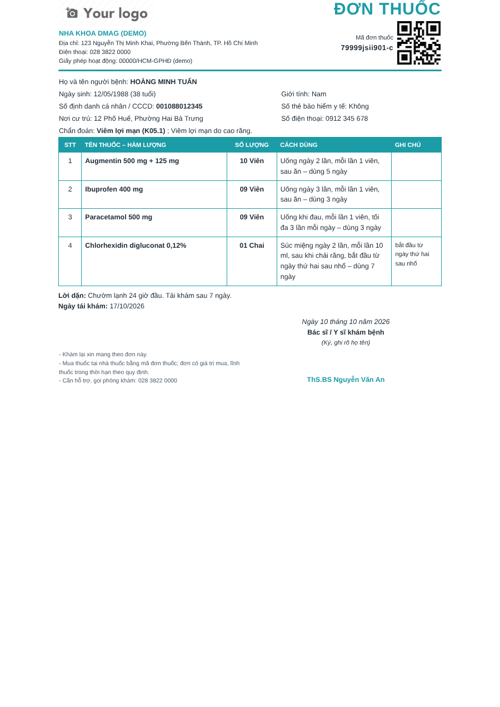
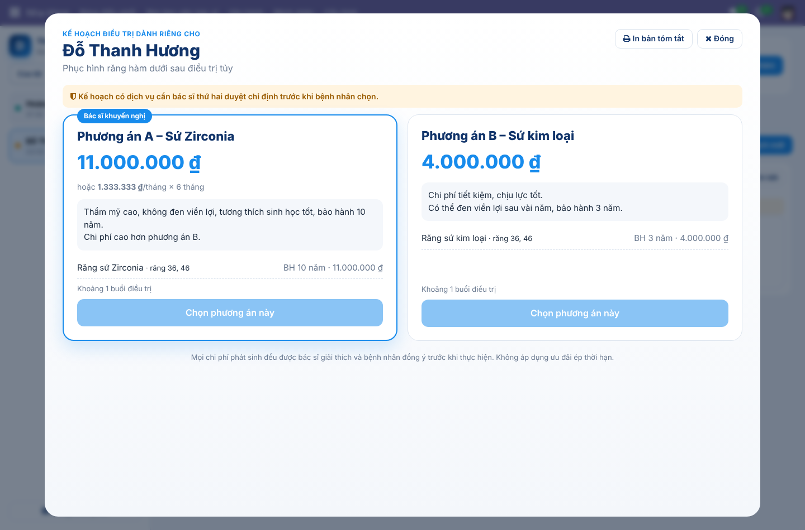
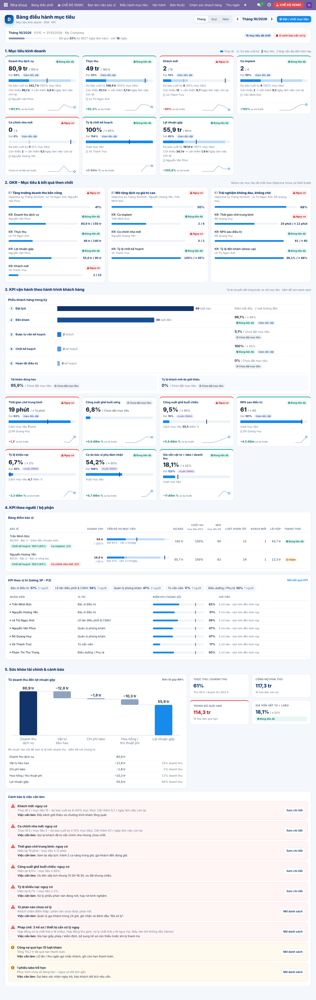

# DMAG Dental ERP – Odoo 17

Bộ module nha khoa của **DMAG – Dental Management & Analytics Group**, xây trên nền Odoo 17 (Bizapps).
Dùng lại các app sẵn có của Bizapps (Kế toán, HĐĐT Viettel, Payroll, Appointment, Sign, Documents, Zalo)
và bổ sung phần nghiệp vụ nha khoa theo hành trình khách hàng, đúng quy định Bộ Y tế.

- Thiết kế: [`docs/DE_XUAT_DENTAL_ERP.md`](docs/DE_XUAT_DENTAL_ERP.md)
- Căn cứ pháp lý: [`docs/PHAP_LY_NHA_KHOA.md`](docs/PHAP_LY_NHA_KHOA.md)
- **Việc cần anh/chị xác nhận trước khi chạy thật: [`docs/CAN_XAC_NHAN.md`](docs/CAN_XAC_NHAN.md)**
- Hiện trạng Bizapps: [`docs/HIEN_TRANG_BIZAPPS.md`](docs/HIEN_TRANG_BIZAPPS.md) · Đánh giá ACS HMS: [`docs/DANH_GIA_ACS_HMS.md`](docs/DANH_GIA_ACS_HMS.md)
- **Cài bản demo để kiểm tra: [`docs/HUONG_DAN_CAI_DEMO.md`](docs/HUONG_DAN_CAI_DEMO.md)**
- Hướng dẫn lập trình: [`docs/DEV_GUIDE.md`](docs/DEV_GUIDE.md)

## Module

| Nhóm | Module | Nội dung |
|---|---|---|
| Lõi | `dmag_dental_base` | Răng FDI, mặt răng, tình trạng, ICD-10; bệnh nhân; ghế; bác sĩ và phạm vi hành nghề; phân quyền 5 cấp |
| | `dmag_dental_clinic` | Lượt khám theo hành trình, sơ đồ răng, kế hoạch điều trị nhiều phương án, thủ thuật, hóa đơn, thuế KCT |
| | `dmag_clinic_workspace` | Giao diện OWL: Bảng điều phối, Bàn làm việc bác sĩ, Chế độ tư vấn, Đặt lịch / Bệnh nhân mới / Thu tiền |
| Y tế – pháp lý | `dmag_dental_emr` | Bệnh án ngoại trú RHM **16/BV1** (TT 32/2023, TT 13/2025), phiếu điều trị, cam kết, tóm tắt hồ sơ, nhật ký truy cập, lưu trữ |
| | `dmag_dental_prescription` | Đơn thuốc điện tử **TT 26/2025**, mã đơn 14 ký tự, liên thông Đơn thuốc quốc gia |
| | `dmag_esign_mysign` | Ký số Viettel MySign cho bệnh án / chứng từ |
| | `dmag_dental_compliance` | Giấy phép, hành nghề, bức xạ, kiểm định, tiệt khuẩn, “Sẵn sàng thanh tra” |
| Thu tiền | `dmag_payment_sepay` | VietQR động + webhook SePay tự gạch nợ, chốt két |
| Khách hàng | `dmag_zalo_zns` | Hạ tầng gửi Zalo ZNS |
| | `dmag_dental_journey` | Điểm chạm Trước – Trong – Sau, NPS, việc CSKH |
| | `dmag_dental_loyalty` | Hạng thành viên, điểm, ví gia đình, giới thiệu, gói chăm sóc |
| | `dmag_patient_portal` | Tài khoản bệnh nhân, đặt lịch online, API cho app di động |
| | `dmag_dental_warranty` | Thẻ bảo hành điện tử |
| Vận hành | `dmag_dental_lab` | Phiếu labo, thử sườn / thử sứ, chi phí labo |
| | `dmag_dental_stock` | Vật tư theo định mức, serial implant, giá vốn / doanh thu |
| Nhân sự | `dmag_hr_3p` | Ngạch bậc P/M (demo), lương 3P xuất cho Payroll Bizapps |
| | `dmag_dental_commission` | Thủ thuật phí, hoa hồng theo thực thu, cầu chì y đức |
| | `dmag_okr_dental` | Cầu nối OKR Scale: KR tự đo từ dữ liệu nha khoa |
| Điều hành | `dmag_dental_goals` | Bảng điều hành mục tiêu: Giám đốc đặt mục tiêu kinh doanh tháng / quý / năm (toàn phòng khám, từng bác sĩ, nhóm theo Objective); thực tế – tiến độ – dự báo cuối kỳ, OKR, KPI hành trình khách hàng, KPI theo người, sức khỏe tài chính, cảnh báo có việc cần làm |
| Demo | `dmag_dental_demo` | Kiểu `social_demo`: giả lập mọi tích hợp, sinh dữ liệu + chính sách mẫu, tài khoản thử theo vai trò; gỡ là sạch |

## Nguyên tắc phân quyền “tạo được – không sửa”

Lễ tân < Phụ tá < Bác sĩ < Quản lý < **Giám đốc / Quản lý cấp cao**. Nhân viên tạo chứng từ. Sau khi chứng từ có
hiệu lực (xác nhận, hoàn tất, ký, phát hành, ghi sổ) thì không ai sửa hoặc xóa được, trừ Giám đốc, và mọi thao tác đều ghi vết.
Bệnh án đã ký và đơn thuốc đã phát hành bị khóa: muốn đổi đơn thì kê đơn thay thế. Giá lấy theo bảng giá;
mức giảm giá vượt ngưỡng phải có Giám đốc duyệt. Lễ tân và bác sĩ không có quyền Bán hàng / Kế toán.

## Ảnh màn hình (dữ liệu mẫu)

| Bảng điều phối | Bàn làm việc bác sĩ – sơ đồ răng |
|---|---|
|  |  |
| **Bệnh án 16/BV1 trên màn hình** | **Kê đơn thuốc TT 26/2025** |
|  |  |
| **Bản in bệnh án 16/BV1** | **Bản in đơn thuốc (mã đơn + QR)** |
|  |  |
| **Chế độ tư vấn 2 phương án** | **Bảng điều hành mục tiêu** |
|  |  |

## Cài đặt

1. Thêm thư mục `addons/` vào `addons_path`. Module `dmag_okr_dental` cần thêm repo OKR Scale.
2. *Ứng dụng → Cập nhật danh sách*, cài **DMAG Clinic Workspace** và các module cần dùng theo gói.
3. *Thiết lập → Công ty*: khai báo **mã cơ sở KCB, số giấy phép hoạt động, người chịu trách nhiệm chuyên môn**. Thiếu các mục này thì ERP chặn phát hành đơn thuốc.
4. *Thiết lập → Người dùng*: gán nhóm **Nha khoa DMAG**.
5. *Nha khoa → Cấu hình*: ghế, bác sĩ (số CCHN, phạm vi), dịch vụ, bảng giá, danh mục thuốc.
6. Server cần **wkhtmltopdf 0.12.6 (patched qt)** để in PDF.

## Kiểm thử

```bash
odoo-bin -c odoo.conf -d test_dmag -i dmag_clinic_workspace,dmag_dental_emr,dmag_dental_prescription \
  --test-tags /dmag_dental_base,/dmag_dental_clinic,/dmag_clinic_workspace,/dmag_dental_emr,/dmag_dental_prescription \
  --stop-after-init
```
