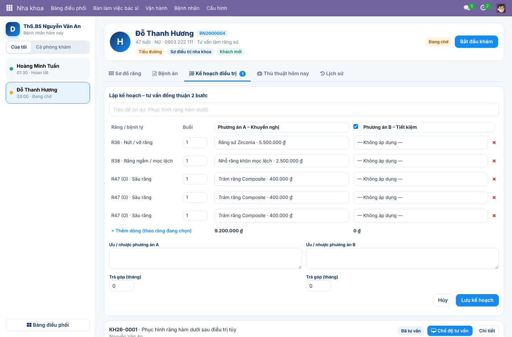

# DMAG Dental ERP – Odoo 17

Bộ module nha khoa của **DMAG – Dental Management & Analytics Group**, xây trên nền Odoo 17 (Bizapps).
Tài liệu thiết kế: [`docs/DE_XUAT_DENTAL_ERP.md`](docs/DE_XUAT_DENTAL_ERP.md) ·
hiện trạng Bizapps: [`docs/HIEN_TRANG_BIZAPPS.md`](docs/HIEN_TRANG_BIZAPPS.md) ·
đánh giá ACS HMS: [`docs/DANH_GIA_ACS_HMS.md`](docs/DANH_GIA_ACS_HMS.md).

## Module

| Module | Nội dung | Phụ thuộc |
|---|---|---|
| `dmag_dental_base` | Răng FDI, mặt răng, tình trạng, ICD-10; bệnh nhân; ghế; bác sĩ (bậc lâm sàng, phạm vi hành nghề, giấy phép); dịch vụ nha khoa; phân quyền | `contacts`, `product`, `hr` |
| `dmag_dental_clinic` | Lượt khám theo hành trình, luật xếp lịch, bệnh án ký/khóa, sơ đồ răng, kế hoạch điều trị nhiều phương án, thủ thuật, thu theo tiến độ | `dmag_dental_base`, `sale_management` |
| `dmag_clinic_workspace` | Giao diện OWL: Bảng điều phối lễ tân, Bàn làm việc bác sĩ, sơ đồ răng chạm, Chế độ tư vấn | `dmag_dental_clinic` |

Chỉ dùng app Community; tích hợp Appointment/Sign/Documents/Payroll của Bizapps, SePay, Viettel MySign, Zalo ZNS
sẽ là các module cầu nối riêng (đã chừa sẵn điểm móc `_dmag_journey_event`, `_dmag_esign_request`).

## Ảnh màn hình (dữ liệu mẫu)

| Bảng điều phối | Sơ đồ răng |
|---|---|
|  |  |
| **Lập kế hoạch 2 phương án** | **Chế độ tư vấn** |
|  |  |

## Cài đặt

1. Thêm thư mục `addons/` của repo vào `addons_path`.
2. *Ứng dụng → Cập nhật danh sách ứng dụng*, cài **DMAG Clinic Workspace** (tự kéo 2 module còn lại).
3. *Thiết lập → Người dùng*: gán nhóm **Nha khoa DMAG** (Lễ tân / Phụ tá / Bác sĩ / Quản lý).
4. *Nha khoa → Cấu hình*: khai báo ghế, bác sĩ (gắn tài khoản đăng nhập), dịch vụ & bảng giá.

## Kiểm thử

```bash
odoo-bin -c odoo.conf -d test_dmag -i dmag_clinic_workspace \
  --test-tags /dmag_dental_base,/dmag_dental_clinic --stop-after-init
```
